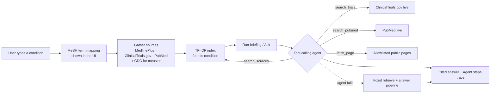

# Condition Research Briefing

Type a condition and get a short research briefing for that condition, where every sentence is cited to a free public source.

**Live demo:** https://medical-briefing.vercel.app (also at the older alias https://measles-briefing.vercel.app)

**One-pager:** [`__demo_deck__.pdf`](./__demo_deck__.pdf) · **Design doc:** [`__design_doc__.pdf`](./__design_doc__.pdf)

## Why it helps

A strategy analyst can get a first-pass briefing on a condition (standard of care, trials in development, organizations involved) without manually searching and reading across several sites. Quality and fidelity stay high:

- **Every sentence is cited.** Each sentence must cite a source chunk that was actually retrieved. Sentences without a valid citation are dropped.
- **Authoritative, free sources:** NLM MeSH, MedlinePlus, ClinicalTrials.gov, PubMed and CDC.
- **No guessing.** When the sources do not support an answer, it says `Not enough evidence in the gathered sources.`

## How it works



1. **Condition to MeSH term.** The app maps what the user typed to the matching NLM MeSH term. It uses NCBI's term mapping first, so lay words work (for example "flu" maps to *Influenza, Human*, D007251). The UI shows the mapping and a link to the MeSH record. If several headings match, the user picks one.
2. **Gather sources.** For the chosen condition it gathers:
   - the MedlinePlus health topic (plus closely related topics);
   - ClinicalTrials.gov studies (recruiting and active ones first);
   - recent PubMed abstracts.

   Measles also includes a CDC clinical overview snapshot. Four quick picks (measles, heart failure, type 2 diabetes, asthma) ship prebuilt. Any other condition is fetched on demand.
3. **Index.** The text is split into chunks with IDs and indexed with a small pure-Python TF-IDF index, scoped to that condition.
4. **Briefing and Ask.** *Run briefing* asks three fixed questions: standard of care, treatments in trials, and organizations involved. *Ask* takes any question. With an LLM configured, each question runs a **tool-calling agent** with four tools:

   | Tool | What it does |
   | --- | --- |
   | `search_sources` | Searches the condition's indexed chunks |
   | `search_trials` | Live ClinicalTrials.gov search, with phase, status and sponsor filters |
   | `search_pubmed` | Live PubMed search for recent abstracts |
   | `fetch_page` | Fetches a page from an allowlisted host: medlineplus.gov, cdc.gov, nih.gov, clinicaltrials.gov, who.int, fda.gov |

   The agent makes at most 4 tool calls per question. Anything a tool fetches is added to the evidence pool. Every answer shows a collapsible **Agent steps** trace (tool, arguments, result, time). The final answer goes through the same citation check as everything else.
5. **Fallback.** If the agent fails or times out, the app uses the fixed pipeline instead (top-ranked chunks, then one LLM answer) and the answer says so. Without an API key, answers are extractive (mock mode), built only from source sentences.

This is a research demo, not medical advice.

## Repo layout

```
.
├── README.md               this file
├── __demo_deck__.pdf       one-pager
├── __design_doc__.pdf      design doc
└── medical-briefing/       the app (FastAPI + one static page)
    ├── app.py              API routes and page
    ├── agent.py            tool-calling agent, tools, fallback
    ├── engine.py           TF-IDF retrieval, citation check, fixed pipeline
    ├── sources.py          MeSH mapping and source fetchers
    ├── static/index.html   UI
    ├── data/corpora/       prebuilt quick-pick corpora
    ├── scripts/fetch_sources.py   refreshes the quick-pick corpora
    └── tests/              pytest suite (LLM and HTTP mocked)
```

## Run locally

Python 3.12 (see `medical-briefing/.python-version`).

```bash
cd medical-briefing
python -m venv .venv && source .venv/bin/activate
pip install -r requirements.txt
uvicorn app:app --host 127.0.0.1 --port 8000
# open http://127.0.0.1:8000
```

Optional environment variables (without `OPENAI_API_KEY` the app runs in mock extractive mode):

| Name | Purpose |
| --- | --- |
| `OPENAI_API_KEY` | Enables the LLM and the tool-calling agent |
| `OPENAI_BASE_URL` | OpenAI-compatible endpoint, e.g. `https://openrouter.ai/api/v1` for OpenRouter (default `https://api.openai.com/v1`) |
| `OPENAI_MODEL` | Model name, e.g. `openai/gpt-4o-mini` on OpenRouter (default `gpt-4o-mini`) |

## Tests

```bash
cd medical-briefing
pytest
```

The tests are deterministic. The LLM is a fake client and outside HTTP is mocked, so no key or network is needed.

## Deploy on Vercel

Import the repo and set **Root Directory** to `medical-briefing`. Vercel picks up the FastAPI `app` in `app.py`. `vercel.json` sets `maxDuration` to 60 s and ships `data/` and `static/` with the function. Add the environment variables above in the project settings. Conditions fetched on demand are cached only in memory and `/tmp`, so a new instance fetches them again.

## Limitations and next steps

- **Consumer-level text.** MedlinePlus is written for patients, so standard-of-care answers are general. Next step: add clinical guideline sources such as NICE (and other specialty guidelines) through `fetch_page` or prebuilt corpora.
- **No persistent cache.** On-demand corpora live in memory and `/tmp` only. Next step: store them durably (for example Vercel Blob or Postgres) with refresh dates.
- **No alerts.** Next step: watch a condition for new trials or papers and send a digest.
- **Citations show provenance, not proof.** The check confirms that every sentence cites a retrieved chunk. It does not prove the sentence says exactly what the chunk says, so cited sources should be read for decisions.
