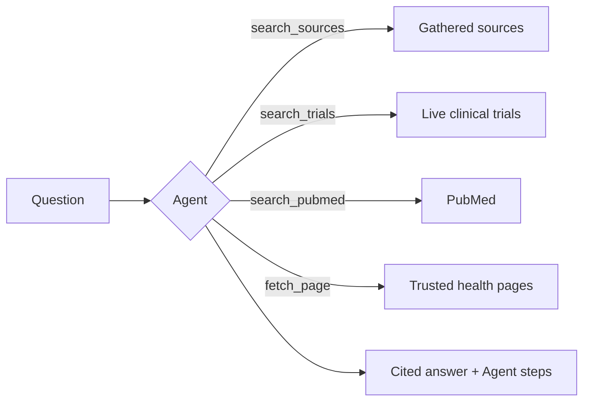

# Condition Research Briefing

Type a condition and get a short research briefing for that condition, where every sentence is cited to a free public source.

**Live demo:** https://medical-briefing.vercel.app (also at the older alias https://measles-briefing.vercel.app)

**One-pager:** [`__demo_deck__.pdf`](./__demo_deck__.pdf) · **Design doc:** [`__design_doc__.pdf`](./__design_doc__.pdf)

## Why it helps

A strategy analyst can get a first-pass briefing on a condition (standard of care, trials in development, organizations involved) without manually searching and reading across several sites. Quality and fidelity stay high:

- **Every sentence is cited.** Each sentence must cite a source chunk that was actually retrieved. Sentences without a valid citation are dropped.
- **Authoritative, free sources:** NLM MeSH, MedlinePlus, ClinicalTrials.gov, PubMed and CDC.
- **No guessing.** When the sources do not support an answer, it says `Not enough evidence in the gathered sources.`

## How it works

The strategy team can research any condition. When they ask a question, **the agent picks the tools it needs and answers only from what it finds, with citations. If the evidence isn't there, it says so.**



**The agent's tools**

| Tool | What it does |
| --- | --- |
| `search_sources` | Search across the gathered sources for the condition |
| `search_trials` | Live ClinicalTrials.gov search (phase, status, sponsor) |
| `search_pubmed` | Live PubMed search for recent papers |
| `fetch_page` | Fetch a trusted health page (MedlinePlus, CDC, NIH, ClinicalTrials.gov, WHO, FDA only) |

Up to 4 tool calls per question. Each answer shows the **Agent steps** it took.

**Before the agent runs:** the condition is mapped to its medical term (MeSH, shown in the UI, e.g. "flu" maps to *Influenza, Human*), and MedlinePlus, ClinicalTrials.gov and PubMed are gathered and indexed for it. If the agent fails, a fixed search-and-answer pipeline takes over. Without an API key the app runs in a mock mode.

See [`__design_doc__.pdf`](./__design_doc__.pdf) for details. This is a research demo, not medical advice.

## Repo layout

```
.
├── README.md               this file
├── __demo_deck__.pdf       one-pager
├── __design_doc__.pdf      design doc
└── medical-briefing/       the app (FastAPI + one static page)
    ├── app.py              API routes and page
    ├── agent.py            tool-calling agent, tools, fallback
    ├── engine.py           TF-IDF retrieval, citation check, fixed pipeline
    ├── sources.py          MeSH mapping and source fetchers
    ├── static/index.html   UI
    ├── data/corpora/       prebuilt quick-pick corpora
    ├── scripts/fetch_sources.py   refreshes the quick-pick corpora
    └── tests/              pytest suite (LLM and HTTP mocked)
```

## Run locally

Python 3.12 (see `medical-briefing/.python-version`).

```bash
cd medical-briefing
python -m venv .venv && source .venv/bin/activate
pip install -r requirements.txt
uvicorn app:app --host 127.0.0.1 --port 8000
# open http://127.0.0.1:8000
```

Optional environment variables (without `OPENAI_API_KEY` the app runs in mock extractive mode):

| Name | Purpose |
| --- | --- |
| `OPENAI_API_KEY` | Enables the LLM and the tool-calling agent |
| `OPENAI_BASE_URL` | OpenAI-compatible endpoint, e.g. `https://openrouter.ai/api/v1` for OpenRouter (default `https://api.openai.com/v1`) |
| `OPENAI_MODEL` | Model name, e.g. `openai/gpt-4o-mini` on OpenRouter (default `gpt-4o-mini`) |

## Tests

```bash
cd medical-briefing
pytest
```

The tests are deterministic. The LLM is a fake client and outside HTTP is mocked, so no key or network is needed.

## Deploy on Vercel

Import the repo and set **Root Directory** to `medical-briefing`. Vercel picks up the FastAPI `app` in `app.py`. `vercel.json` sets `maxDuration` to 60 s and ships `data/` and `static/` with the function. Add the environment variables above in the project settings. Conditions fetched on demand are cached only in memory and `/tmp`, so a new instance fetches them again.

## Limitations and next steps

- **Consumer-level text.** MedlinePlus is written for patients, so standard-of-care answers are general. Next step: add clinical guideline sources such as NICE (and other specialty guidelines) through `fetch_page` or prebuilt corpora.
- **No persistent cache.** On-demand corpora live in memory and `/tmp` only. Next step: store them durably (for example Vercel Blob or Postgres) with refresh dates.
- **No alerts.** Next step: watch a condition for new trials or papers and send a digest.
- **Citations show provenance, not proof.** The check confirms that every sentence cites a retrieved chunk. It does not prove the sentence says exactly what the chunk says, so cited sources should be read for decisions.
